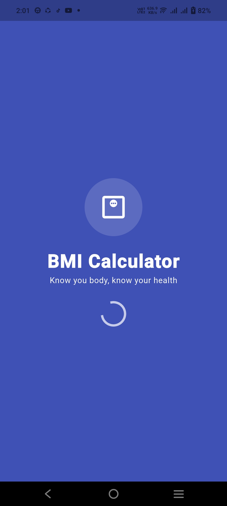
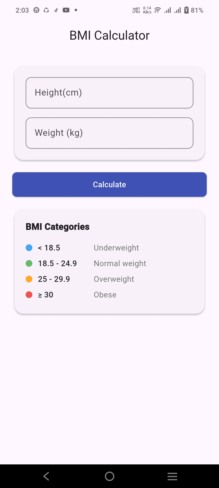
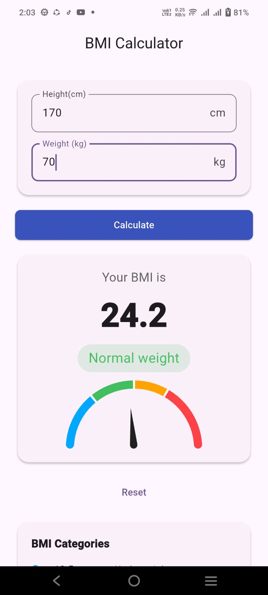

<h1 align="center">⚖️ BMI Calculator App</h1>

<p align="center">
  <strong>A modern, responsive, and beautifully animated Body Mass Index (BMI) health assessment application built with Flutter & Dart.</strong>
</p>

<p align="center">
  <a href="https://flutter.dev"></a>
  <a href="https://dart.dev"></a>
  <a href="LICENSE"></a>
  <a href="https://github.com/biswasbn99/Bmi_Calculator_App/releases"></a>
  <a href="https://github.com/biswasbn99/Bmi_Calculator_App"></a>
</p>

---

## 📖 About This Project

**BMI Calculator App** is a modern health utility built with Flutter and Dart that calculates Body Mass Index (BMI) using metric inputs ($cm$ and $kg$). It provides immediate visual health assessments through an animated radial gauge, color-coded WHO category classifications, and an in-app reference table.

---

## 📑 Table of Contents

- [Executive Project Overview](#-executive-project-overview)
- [The Problem & The Solution](#-the-problem--the-solution)
- [Visual UI Showcase](#-visual-ui-showcase)
- [Explain Features](#-explain-features)
- [Folder & File Architecture](#-folder--file-architecture)
- [Technology Stack, Packages & APIs](#-technology-stack-packages--apis)
- [Installation & Local Setup Guide](#-installation--local-setup-guide)
- [Roadmap & Future Iterations](#️-roadmap--future-iterations)
- [Contributing](#-contributing)
- [License & Authors](#-license--authors)

---

## 🚀 Executive Project Overview

Health awareness begins with accessible, understandable biometric feedback. Body Mass Index (BMI) is widely used by healthcare professionals worldwide as an initial diagnostic screening metric for body fatness and related health risk factors.

The **BMI Calculator App** was built with three primary pillars in mind:
- **Accuracy:** Implementing the clinical Quetelet index formula for metric computation.
- **Visual Clarity:** Replacing plain text numbers with an animated, multi-segment radial gauge needle that visually points to the exact risk level.
- **Frictionless Usability:** Providing instant input validation, error handling, quick resets, and clean material card layouts.

### Application Scope & Capabilities

| Capability | Description |
|:---|:---|
| **Form Input Validation** | Safeguards calculations by validating empty, non-numeric, zero, and negative values. |
| **Accurate Metric Processing** | Computes standardized Body Mass Index using biometric metric inputs ($kg$ and $cm$). |
| **Animated Radial Visualization** | Dynamically scales an elastic gauge needle from 10 to 40 BMI units. |
| **Dynamic Semantic Theming** | Dynamically assigns health status colors (`Blue`, `Green`, `Orange`, `Red`) to reflect risk levels. |
| **Comprehensive Health Reference** | Offers an in-app reference guide displaying all standard BMI ranges for quick education. |
| **State Reset & Replay** | Empties form state and resets visual gauge and result cards cleanly. |

---

## 💡 The Problem & The Solution

```
┌────────────────────────────────────────┐       ┌────────────────────────────────────────┐
│              THE PROBLEM               │       │              THE SOLUTION              │
├────────────────────────────────────────┤       ├────────────────────────────────────────┤
│ ❌ Numbers without medical meaning     │  ───► │ ✅ Instant badge & color-coded status   │
│ ❌ Static, dull presentation           │  ───► │ ✅ Dynamic animated radial needle gauge│
│ ❌ External chart searches required    │  ───► │ ✅ In-app WHO clinical reference table │
│ ❌ Cryptic crash-prone input errors    │  ───► │ ✅ Real-time input validation & hints  │
└────────────────────────────────────────┘       └────────────────────────────────────────┘
```

### The Problem
Traditional health calculators suffer from several critical UX shortcomings:
- **Lack of Immediate Health Context:** Users receive a raw number like `27.8` without knowing what it means for their body.
- **Cluttered & Unfriendly Interfaces:** Many existing solutions are riddled with banner ads or confusing imperial/metric selectors with poor touch targets.
- **No Visual Dial Representation:** Users cannot easily see where they sit between the boundary lines of healthy weight and obesity.

### The Solution
The **BMI Calculator App** addresses these problems through:
- **Instant Contextual Feedback:** Alongside the numeric result, a prominent status badge and color theme immediately communicate the health classification.
- **Animated Dial Gauge:** A custom radial gauge indicator allows users to intuitively see how close they are to adjacent categories.
- **Built-in Education:** An on-screen reference legend provides full transparency into category thresholds without navigating away.

---

## 📱 Visual UI Showcase

Experience the application interface through the captures below:

| 1. Splash Screen | 2. BMI Calculator Screen | 3. BMI Result Screen |
| :---: | :---: | :---: |
|  |  |  |
| **Launch & Brand Experience**<br/>Smooth fade & scale transitions with circular progress indicator. | **Data Entry & Reference**<br/>Clean form inputs with units, validation, and reference table. | **Visual Result & Gauge**<br/>Prominent score, category badge, and animated radial needle gauge. |

---

## ✨ Explain Features

### 1. Animated Splash Screen
- **Technical Implementation:** Uses `SingleTickerProviderStateMixin` with an `AnimationController` configured for 1200ms.
- **Choreography:** Synchronously combines a `FadeTransition` with a `ScaleTransition` (`Tween(begin: 0.8, end: 1.0)` using `Curves.easeIn`).
- **Brand Identity:** Displays the app icon, title, subtitle (*"Know your body, know your health"*), and an indicator before automatically navigating to the calculator screen after 3 seconds.

### 2. Form Validation & User Input Sanitization
- **Modular Inputs:** Encapsulated in the `InputCard` widget with dedicated `_NumericField` controls.
- **Field Constraints:** Enforces `TextInputType.number` to automatically summon the numeric keyboard on mobile devices.
- **Validation Guard:** Checks for empty inputs, invalid character parses, zero, or negative numbers to ensure safe mathematical operations.

### 3. Metric Quetelet BMI Computation Engine
- Converts centimeters ($cm$) into meters ($m$):
  $$\text{Height (m)} = \frac{\text{Height (cm)}}{100}$$
- Calculates BMI using the clinical formula:
  $$\text{BMI} = \frac{\text{Weight (kg)}}{[\text{Height (m)}]^2}$$
- Formats output to a clean single decimal precision (`toStringAsFixed(1)`).

### 4. Animated Radial Gauge Indicator
- **Package Integration:** Leverages `gauge_indicator` to render an `AnimatedRadialGauge`.
- **Dynamic Physics:** Needle animates using `Curves.elasticOut` over an 800ms duration.
- **4 Distinct Colored Zones:**
  - `10.0 - 18.5`: **Underweight** (Blue `#42A5F5`)
  - `18.5 - 25.0`: **Normal weight** (Green `#66BB6A`)
  - `25.0 - 30.0`: **Overweight** (Orange `#FFA726`)
  - `30.0 - 40.0`: **Obese** (Red `#EF5350`)

### 5. In-App Reference Matrix Card
- Provides an immediate reference card (`BmiReferenceTable`) displaying all 4 categories and their exact numeric intervals.
- Features matching chromatic indicators for effortless visual correlation.

### 6. One-Tap Form Reset
- Includes a clean `Reset` button that clears text controllers and resets the calculation state, allowing users to perform another calculation instantly.

---

## 📂 Folder & File Architecture

The project is structured according to clean code principles, separating presentation components from core constants:

```text
bmi_calculator_app/
│
├── android/                             # Android native platform code & build scripts
├── ios/                                 # iOS native platform code & build scripts
├── web/                                 # Web platform entry points & icons
├── windows/                             # Windows desktop platform code
├── macos/                               # macOS desktop platform code
├── linux/                               # Linux desktop platform code
│
├── screenshots/                         # Visual application UI captures
│   ├── splash_screen.jpeg               # Animated splash screen showcase
│   ├── BMI_Calculator_Screen.jpeg       # Form inputs & reference screen showcase
│   └── BMI_result_screen.jpeg           # Calculated score & radial gauge showcase
│
├── lib/                                 # Main Dart source code
│   ├── core/                            # Global app-wide definitions
│   │   └── app_colors.dart              # Semantic colors, theme tokens & category palettes
│   │
│   ├── presentation/                    # UI layer (Screens & Widgets)
│   │   ├── screens/                     # Full-screen view widgets
│   │   │   ├── splash_screen.dart           # Animated splash screen with auto-navigation
│   │   │   └── bmi_calculator_screen.dart   # Main screen containing state & calculation logic
│   │   │
│   │   └── widgets/                     # Reusable modular UI components
│   │       ├── input_card.dart              # Card containing height & weight fields + validators
│   │       ├── result_card.dart             # Output card with score, badge, & radial gauge
│   │       └── bmi_reference_table.dart     # WHO category reference legend
│   │
│   ├── bmi_calculator_app.dart          # MaterialApp configuration, routes & theme setup
│   └── main.dart                        # Application bootstrap entry point
│
├── test/                                # Automated tests
│   └── widget_test.dart                 # Widget testing suite
│
├── pubspec.yaml                         # Package dependencies, fonts & metadata
├── analysis_options.yaml                # Dart & Flutter linting rules
├── LICENSE                              # MIT Open Source License
└── README.md                            # Comprehensive project documentation
```

---

## ⚙️ Technology Stack, Packages & APIs

### Technologies & Tools Summary

| Category | Technology / Tool | Purpose in Project |
|:---|:---|:---|
| **Core Framework** | [Flutter SDK](https://flutter.dev/) (v3.x / SDK `^3.12.2`) | Cross-platform UI development for Android, iOS, Web & Desktop |
| **Language** | [Dart](https://dart.dev/) | Strongly-typed object-oriented programming with Dart 3 Pattern Matching & Records |
| **UI Components** | [gauge_indicator](https://pub.dev/packages/gauge_indicator) | Animated radial speed-dial gauge with needle pointer and custom color zones |
| **Iconography** | [cupertino_icons](https://pub.dev/packages/cupertino_icons) & Material Icons | Crisp, cross-platform vector icons |
| **Design System** | Material Design 3 | Card elevations, custom typography, rounded borders, and semantic color palette |
| **Code Quality** | [flutter_lints](https://pub.dev/packages/flutter_lints) (`^6.0.0`) | Static code analysis and enforcement of Dart style guidelines |
| **Version Control** | Git & [GitHub](https://github.com/biswasbn99/Bmi_Calculator_App) | Source code management and repository hosting |
| **IDEs / Editors** | VS Code & Android Studio | Application development, debugging, and testing |

### Framework & Language Highlights
- **[Flutter](https://flutter.dev/):** Google's cross-platform UI toolkit targeting high 60fps/120fps performance.
- **[Dart](https://dart.dev/):** Modern client-optimized programming language utilizing modern Dart 3 features like pattern matching and records:
  ```dart
  (String, Color) _classify(double bmi) {
    if (bmi < 18.5) return ('Underweight', AppColors.underweight);
    if (bmi < 25) return ('Normal weight', AppColors.normal);
    if (bmi < 30) return ('Overweight', AppColors.overweight);
    return ('Obese', AppColors.obese);
  }
  ```

### External Packages & Plugins
- **[`gauge_indicator`](https://pub.dev/packages/gauge_indicator):** Utilized for the radial gauge visualization:
  - Custom `GaugeAxis` style with zone spacing and customized needle pointers.
  - Smooth animation transitions using `AnimatedRadialGauge`.
- **[`cupertino_icons`](https://pub.dev/packages/cupertino_icons):** iOS-styled iconography.
- **[`flutter_lints`](https://pub.dev/packages/flutter_lints):** Strict code analysis rules maintaining enterprise code quality.

---

## 🚀 Installation & Local Setup Guide

Follow this step-by-step guide to clone and run the application locally on your workstation:

### 1. Prerequisites
Verify that your machine has the following tools installed:
- [Flutter SDK](https://docs.flutter.dev/get-started/install) (`>= 3.12.2`)
- [Dart SDK](https://dart.dev/get-dart)
- [Git](https://git-scm.com/)
- Android Studio / VS Code with Flutter extensions installed
- An active Android emulator, iOS simulator, or connected physical device

Check your environment setup:
```bash
flutter doctor
```

### 2. Clone the Repository
```bash
git clone https://github.com/biswasbn99/Bmi_Calculator_App.git
cd Bmi_Calculator_App
```

### 3. Fetch Dependencies
Download all required packages:
```bash
flutter pub get
```

### 4. Verify Connected Devices
```bash
flutter devices
```

### 5. Launch the Application
Start the app in debug mode on your connected target:
```bash
flutter run
```

---

## 🗺️ Roadmap & Future Iterations

We are continuously planning enhancements to make the app even more comprehensive:

- [ ] **Dual Measurement System:** Add a seamless toggle between Metric ($cm$, $kg$) and Imperial ($ft/in$, $lbs$).
- [ ] **Calculation History & Persistence:** Local storage integration (via Hive or SharedPreferences) to record past entries with timestamps.
- [ ] **Visual Progress Graphs:** Track weight and BMI trends over time using interactive line charts.
- [ ] **Advanced Health Metrics:** Calculate Basal Metabolic Rate (BMR) and Ideal Body Weight (IBW) based on age and biological sex.
- [ ] **Dark Mode / Dynamic Theming:** Full support for dark theme and system-level brightness transitions.
- [ ] **PDF & Social Sharing:** Export personal health assessment reports as downloadable PDFs or shareable cards.

---

## 🤝 Contributing

Contributions make the open-source community an incredible place to learn, inspire, and create. Any contributions you make are **greatly appreciated**.

1. **Fork the Repository**
2. **Create a Feature Branch:**
   ```bash
   git checkout -b feature/YourFeatureName
   ```
3. **Commit your Changes:**
   ```bash
   git commit -m "feat: Add YourFeatureName"
   ```
4. **Push to the Branch:**
   ```bash
   git push origin feature/YourFeatureName
   ```
5. **Open a Pull Request**

---

## 📄 License & Authors

Distributed under the **MIT License**. See [`LICENSE`](LICENSE) for complete details.

### Author & Maintainer
- **Bn Biswas**
  - **GitHub:** [@biswasbn99](https://github.com/biswasbn99)
  - **Repository:** [https://github.com/biswasbn99/Bmi_Calculator_App](https://github.com/biswasbn99/Bmi_Calculator_App)

---

<p align="center">
  Crafted with care by <strong>Bn Biswas</strong>
</p>
